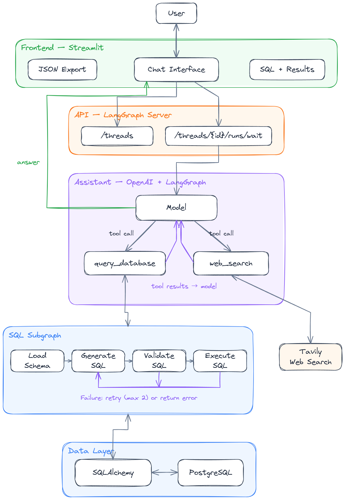
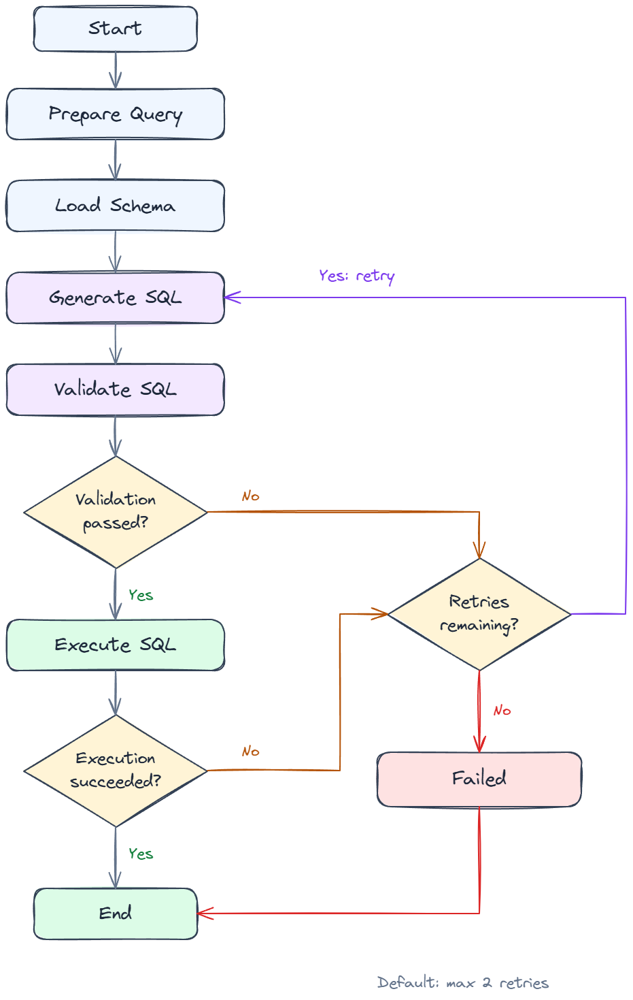

# SQL Agent

A natural language interface to PostgreSQL, built with LangChain and LangGraph and served through a Streamlit chat UI. An OpenAI-powered assistant selects database queries or web search, delegates SQL work to a dedicated graph, and returns an answer with the generated SQL and retrieved rows.

## Table of Contents

- [Architecture Overview](#architecture-overview)
- [ReAct Agent Loop](#react-agent-loop)
- [SQL Subgraph](#sql-subgraph)
- [Technology Stack](#technology-stack)
- [Project Structure](#project-structure)
- [Backend API Reference](#backend-api-reference)
- [Frontend](#frontend)
- [LangGraph Studio](#langgraph-studio)
- [Evaluation](#evaluation)
- [Configuration](#configuration)
- [Getting Started](#getting-started)

## Architecture Overview

The **Streamlit** frontend creates a conversation thread on the **LangGraph Agent Server** and submits each message through its wait endpoint. The main assistant uses **OpenAI** to choose between a **SQL subgraph** and **Tavily web search**. Database queries run against PostgreSQL through SQLAlchemy; tool results return to the assistant before it produces the final response.

<p align="center">
  
</p>

## ReAct Agent Loop

The main agent is created with LangChain's `create_agent` in `agent/assistant.py`. It follows a model–tool–model loop: select a tool, inspect its result, and either continue working or return an answer. Parallel tool calls are disabled.

**Available tools:**

| Tool | Purpose |
| :--- | :--- |
| `query_database` | Send a self-contained database question to the SQL subgraph; save the schema, SQL and retrieved rows in agent state |
| `web_search` | Search the web with Tavily and return up to three results |

The database tool sends a compact result preview to the model while retaining the retrieved rows for the frontend. Previews exceeding 6,000 characters are reduced to five rows, or an empty preview if still too large.

## SQL Subgraph

The SQL workflow is defined in `agent/graph.py`. It prepares the question, loads the public schema and foreign keys, generates SQL, validates it, and executes it. Validation failures and caught SQL execution errors return to SQL generation while retries remain.

<p align="center">
  
</p>


| Step | Responsibility |
| :--- | :--- |
| `prepare_query` | Initialize per-query state and the retry budget |
| `load_schema` | Reuse cached schema context or inspect PostgreSQL tables, columns and foreign keys |
| `generate_sql` | Generate structured SQL output; use the previous SQL and error on retries |
| `validate_sql` | Ask the model to validate the query using a structured validation schema |
| `retrieve_sql` | Execute validated SQL and collect results |
| `failed_generate_sql` | Return a failure when the retry budget is exhausted |

The default budget allows **one initial attempt plus two retries**. Schema-loading failures and model-provider failures are outside this SQL retry loop. Database execution uses a **read-only transaction**, a **10-second statement timeout**, and a **100-row fetch limit**. The displayed and downloaded results contain only those fetched rows.

## Technology Stack

| Layer | Technology | Purpose |
| :--- | :--- | :--- |
| Agent framework | LangChain `create_agent` | Tool selection and conversational responses |
| Workflow engine | LangGraph | Main agent execution and explicit SQL graph routing |
| Language model | OpenAI | Assistant reasoning, SQL generation and validation |
| API runtime | LangGraph Agent Server | Conversation threads and graph runs |
| Frontend | Streamlit, pandas, requests | Chat, result tables and HTTP communication |
| Database | PostgreSQL, SQLAlchemy, psycopg | Schema inspection and SQL execution |
| Web search | Tavily | External information retrieval |
| Structured output | Pydantic | SQL generation and validation models |
| Configuration | python-dotenv, dataclasses | Environment loading and graph configuration |
| Container runtime | Docker Compose, Redis, PostgreSQL | Agent Server services and persistence |
| Tracing | LangSmith, when configured | Agent execution traces |

## Project Structure

```text
sql-agent/
|-- agent/
|   |-- __init__.py
|   |-- assistant.py          # Main agent and registered graph
|   |-- configuration.py      # Model and retry configuration
|   |-- database.py           # Schema inspection and read-only SQL execution
|   |-- graph.py              # SQL subgraph and retry routing
|   |-- prompts.py            # Assistant and SQL prompts
|   |-- schemas.py            # Structured SQL output models
|   |-- state.py              # Main agent and SQL graph state
|   |-- tools.py              # query_database and web_search
|-- frontend/
|   |-- app.py                # Streamlit chat interface
|   |-- client.py             # LangGraph HTTP client and result normalization
|-- docs/
|   |-- images/               # README workflow images
|   |-- diagrams/             # Editable Excalidraw source files
|-- docker-compose.yml        # API, frontend, Redis and persistence database
|-- Dockerfile.frontend       # Frontend container
|-- langgraph.json            # Graph registration
|-- pyproject.toml            # Python package metadata and backend dependencies
|-- requirements.txt          # Application dependencies
|-- .env                      # Local configuration; do not commit credentials
|-- README.md
```

## Backend API Reference

The frontend uses the native LangGraph Agent Server API. The default local base URL is `http://127.0.0.1:8123`.

| Method | Endpoint | Description | Response |
| :--- | :--- | :--- | :--- |
| POST | `/threads` | Create a conversation thread | Thread object containing `thread_id` |
| POST | `/threads/{thread_id}/runs/wait` | Run the assistant and wait for completion | Final graph state |

Example run payload:

```json
{
  "assistant_id": "sql_agent",
  "input": {
    "messages": [
      {"type": "human", "content": "How many customers are in the database?"}
    ]
  },
  "config": {"recursion_limit": 30}
}
```

### Frontend Response Mapping

`frontend/client.py` converts the returned graph state into the following UI fields. These are client-side fields, not a separate server response model.

| Field | Description |
| :--- | :--- |
| `session_id` | Conversation thread ID |
| `answer` | Final assistant text for the current turn |
| `database_used` | Whether the current turn called `query_database` |
| `sql` | Latest SQL for the current turn, when the database tool was used |
| `results` | Retrieved rows retained in agent state |
| `query_status`, `query_error` | Database tool outcome |
| `preview_only` | Whether the model received a reduced result preview |

The current frontend waits for completion; it does not render a live token or tool-event stream. Input is limited to 1–4,000 characters, with a 600-second HTTP read timeout for runs.

## Frontend

The Streamlit frontend in `frontend/` provides:

- **Conversational chat** with follow-up questions in the same server thread.
- **New conversations** with a fresh thread ID.
- **SQL inspection** through an expandable query panel.
- **Result tables** displaying retrieved rows and their count.
- **JSON download** through `query_results.json`.

## LangGraph Studio

The project registers its main assistant in `langgraph.json`:

```json
{
  "dependencies": ["."],
  "graphs": {"sql_agent": "agent.assistant:graph"},
  "env": ".env",
  "python_version": "3.11"
}
```

Start the development server from the repository root:

```powershell
.\.venv\Scripts\langgraph.exe dev --host 127.0.0.1 --port 8123 --allow-blocking --no-browser
```

Use the Studio URL printed in the terminal to inspect the registered agent and test messages. The SQL subgraph is invoked inside `query_database` and is compiled without its own checkpointer.

## Configuration

Backend environment values are loaded from `.env`. `agent/configuration.py` resolves model and retry settings from runnable configuration first, then environment variables, then defaults. The main assistant model is initialized when the module loads, so restart the backend after changing `OPENAI_MODEL`.

| Setting | Default | Description |
| :--- | :--- | :--- |
| `OPENAI_API_KEY` | Required | OpenAI API credential |
| `OPENAI_MODEL` | `gpt-5.4-mini` | Model name configured by the project; choose one available to your account |
| `TAVILY_API_KEY` | Required | Tavily credential for the initialized search tool |
| `DB_HOST` | `localhost` | Target PostgreSQL hostname; explicitly required by Compose |
| `SQL_AGENT_DB_HOST` | Unset | Override for the target database host |
| `DB_PORT` | `5432` | Target PostgreSQL port |
| `DB_NAME` | `pagila` | Target database name |
| `DB_USER` | Required | Target database username |
| `DB_PASSWORD` | Required | Target database password |
| `MAX_RETRY_COUNT` | `2` | SQL retries after the initial attempt |
| `API_URL` | `http://127.0.0.1:8123` | Backend address used by the frontend |
| `LANGGRAPH_ASSISTANT_ID` | `sql_agent` | Registered assistant used by the frontend |
| `LANGSMITH_TRACING` | Unset | Enable tracing when configured |
| `LANGSMITH_API_KEY` | Unset locally | Tracing credential; required by the supplied Compose configuration |
| `LANGSMITH_PROJECT` | Unset | LangSmith trace project |
| `LANGGRAPH_POSTGRES_PASSWORD` | Required for Compose | Password for the Agent Server persistence database |

The frontend reads `API_URL` and `LANGGRAPH_ASSISTANT_ID` from its process environment. Set them in its terminal, or through Compose.

## Getting Started

### Prerequisites

- Python 3.11 or later.
- A running PostgreSQL instance with a populated database, such as Pagila.
- OpenAI and Tavily API keys.
- Docker Desktop for the optional container setup.

### Installation

The examples below use Windows PowerShell:

```powershell
git clone https://github.com/KevinZQT/langgraph-SQL-agent.git
cd langgraph-SQL-agent
python -m venv .venv
.\.venv\Scripts\python.exe -m pip install --upgrade pip
.\.venv\Scripts\python.exe -m pip install -r requirements.txt
.\.venv\Scripts\python.exe -m pip install "langgraph-cli[inmem]>=0.4,<0.5" colorama
```

### Environment Variables

Create `.env` in the repository root and replace the placeholders:

```dotenv
OPENAI_API_KEY=your_openai_api_key
OPENAI_MODEL=gpt-5.4-mini
TAVILY_API_KEY=your_tavily_api_key

DB_HOST=127.0.0.1
DB_PORT=5432
DB_NAME=pagila
DB_USER=your_database_user
DB_PASSWORD=your_database_password
MAX_RETRY_COUNT=2

# Optional for local development
LANGSMITH_TRACING=false
LANGSMITH_PROJECT=sql-agent
```

Use a database account with only the permissions needed to query your data. Keep `.env` out of version control.

### Running the Application Locally

Open two terminals in the repository root.

**Terminal 1 — backend:**

```powershell
$env:PYTHONUTF8 = "1"
$env:SQL_AGENT_DB_HOST = "127.0.0.1"
.\.venv\Scripts\langgraph.exe dev --host 127.0.0.1 --port 8123 --allow-blocking --no-browser
```

Set `SQL_AGENT_DB_HOST` to your database host if PostgreSQL runs elsewhere.

**Terminal 2 — frontend:**

```powershell
$env:API_URL = "http://127.0.0.1:8123"
$env:LANGGRAPH_ASSISTANT_ID = "sql_agent"
.\.venv\Scripts\python.exe -m streamlit run frontend/app.py --server.address 127.0.0.1 --server.port 8502
```

Open [the local chat interface](http://127.0.0.1:8502). Keep both processes running. If the UI cannot connect to the backend, check that the backend started successfully on port 8123 and that `API_URL` points to it.

### Running with Docker Compose

The supplied Compose file starts the frontend, Agent Server, Redis and a PostgreSQL database for server persistence. Your **query database is separate** and must already exist.

For a target database running on the Windows host, update `.env`:

```dotenv
DB_HOST=host.docker.internal
LANGGRAPH_POSTGRES_PASSWORD=your_server_database_password
LANGSMITH_API_KEY=your_langsmith_api_key
```

Leave `SQL_AGENT_DB_HOST` unset in `.env` for this setup so it does not override `DB_HOST`. Then build and start:

```powershell
.\.venv\Scripts\langgraph.exe build -t sql-langgraph-api:latest
docker compose up --build -d
docker compose logs -f langgraph-api frontend
```

Open [the containerized chat interface](http://127.0.0.1:8501). The API is exposed at `http://127.0.0.1:8123`. Stop a locally running backend before starting Compose, because both use port 8123.

```powershell
docker compose down
```

This stops the services while retaining the named persistence volume.
